## `05 / ACTIVITY & STATISTICS`

<!-- Third-party image services can occasionally be unavailable. -->

## `06 / CURRENTLY EXPLORING`

`GO CONCURRENCY` · `SYSTEM DESIGN` · `AI AGENTS` · `EVENT-DRIVEN SYSTEMS` · `CLOUD INFRASTRUCTURE`

