<div align="center">
  

  <a href="https://github.com/patryk-rozycki"></a>
  <a href="https://www.linkedin.com/in/patryk-r%C3%B3%C5%BCycki-593430261/"></a>
</div>

<br />

<div align="center">
  
</div>

### `01 / ABOUT`

I build **end-to-end software systems** — from frontend interfaces and APIs to automation workflows and AI integrations. My focus is on **backend engineering, AI-powered products and scalable SaaS**.

I like solving real business problems, understanding how systems work under the hood, and shipping software that people actually use.

```yaml
focus:
  - Backend engineering & system design
  - AI agents, integrations & automation
  - SaaS products & rapid MVP development
  - Reliable APIs & asynchronous workflows
location: Poland · Remote
```

### `02 / TECH STACK`

<div align="center">
  
</div>

### `03 / SELECTED WORK`

<table>
<tr><td width="50%">

**✦ AI Workflow Automation**  
Automation pipelines, API integrations and intelligent processing of business data.  
`Python` · `APIs` · `Playwright`

</td><td width="50%">

**✦ Lumii — AI Inbox**  
An AI-assisted inbox and workflow concept focused on email operations.  
`FastAPI` · `React` · `AI`

</td></tr>
<tr><td width="50%">

**✦ DesklyAI**  
Website chatbot concept for customer communication and CRM workflows.  
`Full-stack` · `AI` · `Integrations`

</td><td width="50%">

**✦ Full-Stack Engineering**  
Web applications, dashboards and business-focused integrations.  
`Next.js` · `TypeScript` · `Backend`

</td></tr>
</table>

> Some commercial work is private. Project descriptions are intentionally high-level.

### `04 / ACTIVITY`

<div align="center">
  
  
</div>

<div align="center">
  
</div>

### `05 / CURRENTLY EXPLORING`

```text
[+] Go concurrency and backend architecture
[+] Agentic AI systems and workflow orchestration
[+] Distributed systems and production observability
[+] Building and validating SaaS products
```

<div align="center">
  
</div>
